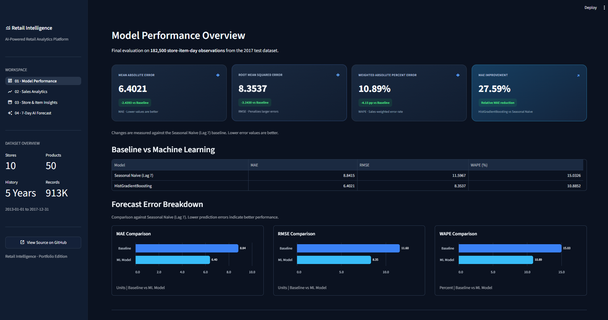
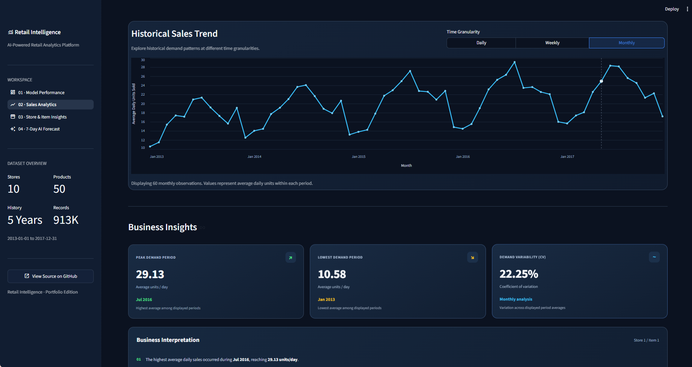
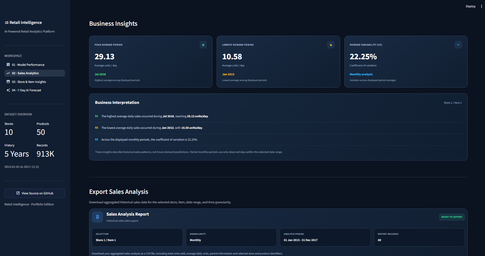
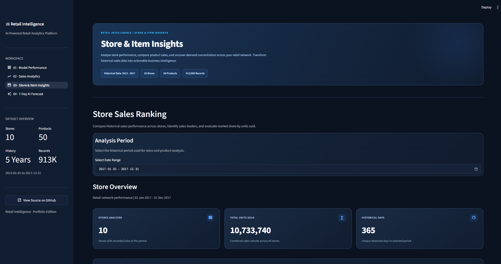
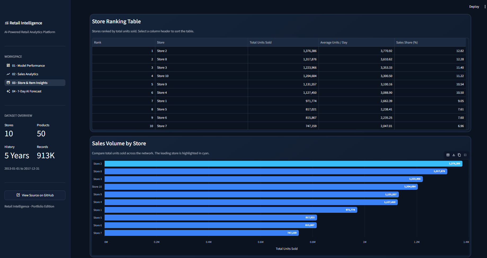
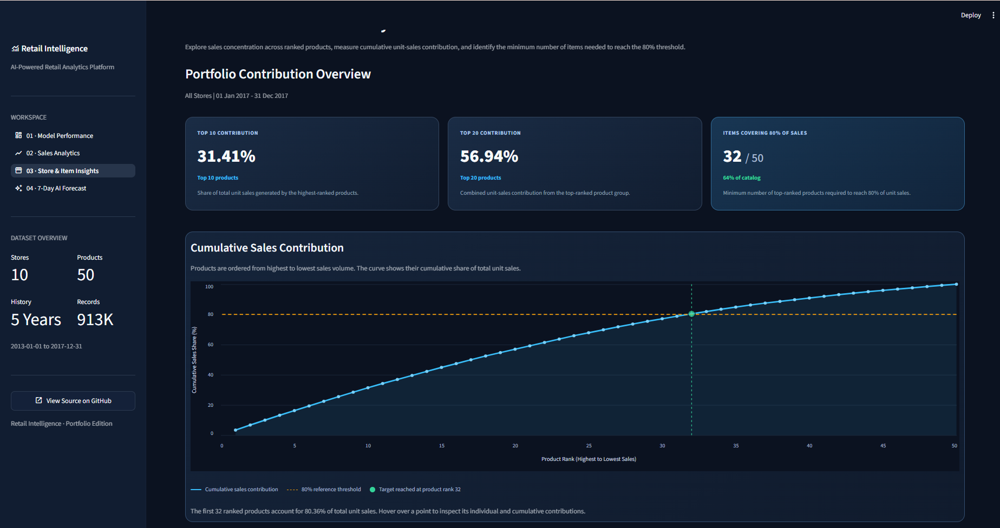
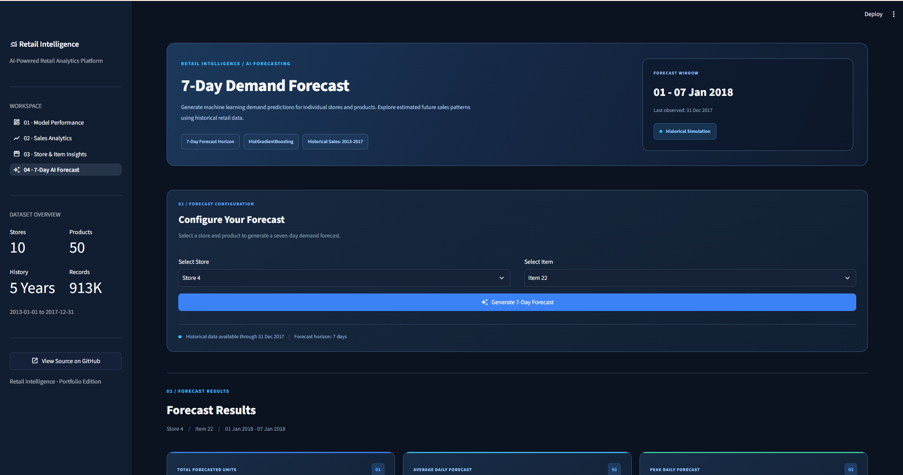
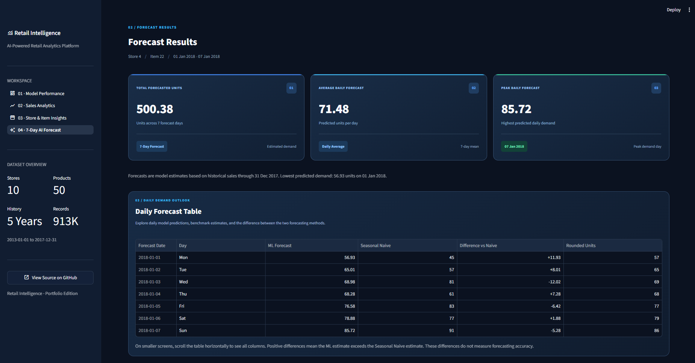
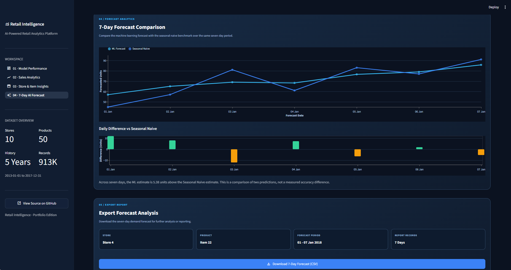

# Retail Demand Forecasting

### Live Application

**[Launch Live Demo](https://retail-demand-forecasting-wxzynardzz5nu74kmc99zr.streamlit.app/)** | **[View Source Code](https://github.com/khimneae/retail-demand-forecasting)**

> **Demo Mode:** The live application uses independently generated synthetic retail sales data. The reported machine learning evaluation results were obtained from the original Kaggle dataset. Forecasts generated using synthetic data are illustrative and have not been separately validated.

**End-to-End Machine Learning and Interactive Retail Analytics**

An end-to-end retail demand forecasting project that combines historical sales analysis, feature engineering, machine learning, quantitative evaluation, and an interactive **Streamlit** dashboard.

The project turns daily store–item sales records into interpretable business insights and short-term demand estimates. It demonstrates both the modeling workflow and an application that makes the results accessible to users.

## Project Highlights

| Dataset | Forecasting | Machine Learning | Evaluation |
| :--- | :--- | :--- | :--- |
| **913,000** daily observations | **7-day** demand horizon | **HistGradientBoostingRegressor** | **27.59%** lower MAE than baseline |
| **10** stores × **50** items | Store–item-level predictions | Calendar, lag, and rolling features | **182,500** test observations (2017) |

- Historical coverage: **January 1, 2013 – December 31, 2017**.
- Four interactive modules: **Model Performance**, **Sales Analytics**, **Store & Item Insights**, and **7-Day AI Forecast**.
- Exportable analysis and forecast results, together with reproducible evaluation scripts.

## Dashboard Preview



*Retail Intelligence dashboard: historical model performance and baseline comparison.*

## Interactive Dashboard

### 1. Model Performance

Evaluate the **HistGradientBoostingRegressor** against a **Seasonal Naive (Lag-7)** baseline using **MAE**, **RMSE**, and **WAPE**. Review the size of the evaluation set, performance gains, and the test methodology.

The dashboard overview above shows this module's performance summary.

### 2. Sales Analytics

Explore historical sales using store, item, and date filters. Examine daily, weekly, and monthly trends, key performance indicators, variability, and downloadable CSV results.

<p align="center">
  
  
</p>

### 3. Store & Item Insights

Compare store performance and product demand. Analyze store rankings, item contributions, and the concentration of sales across the product catalog.

<p align="center">
  
  
</p>
<p align="center">
  
</p>

### 4. 7-Day AI Forecast

Generate a **seven-day demand forecast** for a selected store and item. Compare model predictions with a seasonal naive reference, inspect daily results, and export predictions as CSV.

<p align="center">
  
  
</p>
<p align="center">
  
</p>

**Demonstration period:** January 1–7, 2018, using observed sales history available through December 31, 2017. This is a **historical simulation**, not a live production forecast.

## Machine Learning Methodology

The workflow covers:

1. **Data validation and exploratory data analysis** — inspect completeness, trends, and seasonality.
2. **Feature engineering** — construct calendar, lag, and rolling-mean predictors.
3. **Training and validation** — fit and compare a gradient-boosting model against a simple seasonal baseline.
4. **Final test evaluation** — measure errors on the held-out 2017 test period.
5. **Deployment-model refit** — prepare a saved model for the historical seven-day demonstration.
6. **Interactive forecasting** — generate and export store–item-level results from Streamlit.

The deployed forecasting model uses the following features:

`store`, `item`, `year`, `month`, `day_of_week`, `is_weekend`, `lag_7`, `lag_14`, `lag_28`, `rolling_mean_7`, and `rolling_mean_28`.

### Final Model Evaluation

The results below come from `reports/metrics/final_test_results.json`.

| Metric | Seasonal Naive Baseline | HistGradientBoostingRegressor |
| :--- | ---: | ---: |
| **MAE** | 8.8415 | **6.4021** |
| **RMSE** | 11.5967 | **8.3537** |
| **WAPE** | 15.03% | **10.89%** |

**MAE reduction: 27.59%** compared with the seasonal naive baseline.

**Evaluation protocol**

- **Test set:** 182,500 store–item observations from 2017.
- **Forecast horizon:** 7 days.
- **Protocol:** Rolling-origin evaluation with observed history.
- **Reported training cutoff:** December 24, 2016.

> **Interpretation:** The reported rolling-origin test metrics use observed historical sales to construct lag and rolling features. They are **not** evidence of the same accuracy in a fully recursive, unattended production forecasting scenario.

## Technology Stack

| Area | Technologies |
| :--- | :--- |
| Language | Python 3.13 |
| Dashboard | Streamlit |
| Data processing | Pandas, NumPy |
| Machine learning | Scikit-learn (`HistGradientBoostingRegressor`) |
| Model persistence | Joblib |
| Charts and visualization | Altair, Matplotlib |
| Version control | Git, GitHub |

Exact Python package versions are specified in [`requirements.txt`](requirements.txt).

## Project Structure

```text
retail-demand-forecasting/
├── .streamlit/
│   └── config.toml            # Streamlit theme and settings
├── app/
│   ├── assets/                # Dashboard and responsive CSS
│   ├── pages/                 # Sales, store–item, and forecast pages
│   ├── dashboard.py           # Model Performance page
│   └── main.py                # Streamlit entry point
├── data/
│   ├── raw/                   # Historical source data
│   └── processed/             # Locally generated features (not tracked)
├── docs/
│   └── images/                # README screenshots
├── models/                    # Saved trained and deployment models
├── notebooks/                 # Exploratory notebooks, if present
├── reports/                   # Evaluation metrics, plots, forecasts
├── src/                       # Data preparation, training, evaluation
├── tests/                     # Automated data and UI consistency checks
├── requirements.txt
└── README.md
```

## Getting Started

### 1. Clone the repository

```bash
git clone https://github.com/khimneae/retail-demand-forecasting.git
cd retail-demand-forecasting
```

### 2. Create and activate a virtual environment

```powershell
python -m venv .venv
.\.venv\Scripts\Activate.ps1
```

For macOS/Linux, activate it with `source .venv/bin/activate` instead.

### 3. Install dependencies

```bash
python -m pip install -r requirements.txt
```


### Data Sources

The application supports two data sources:

**1. Synthetic Demo Dataset (Default for Online Deployment)**

The repository includes an independently generated synthetic dataset at:

`data/demo/synthetic_sales.csv`

This dataset allows users to explore all four dashboard modules
without downloading the original Kaggle competition data.

To regenerate the synthetic dataset:

```bash
python src/generate_demo_data.py
```

**2. Original Kaggle Dataset (Optional)**

The original dataset comes from the
[Store Item Demand Forecasting Challenge](https://www.kaggle.com/competitions/demand-forecasting-kernels-only/data).

To use it locally:

1. Sign in to Kaggle and accept the competition rules.
2. Download and extract the dataset.
3. Place `train.csv` in `data/raw/`.

The original dataset is not redistributed in this repository.

**Data Source Selection**

- `auto` (default): Use Kaggle data if available; otherwise use synthetic demo data.
- `demo`: Always use synthetic demo data.
- `original`: Require the original Kaggle dataset.

Set the `RETAIL_DATA_MODE` environment variable to override the default.

**Important:** Published model evaluation metrics were obtained
using the original Kaggle dataset. Predictions generated from
synthetic demo data are illustrative and have not been validated
against that dataset.


### 4. Run the dashboard

```bash
python -m streamlit run app/main.py
```

Open the URL shown in the terminal (normally `http://localhost:8501`).

### 5. Run automated checks

```bash
python tests/check_ui_07_3.py
```

The latest local validation run completed successfully:
25 automated checks passed, 0 failed. These checks cover data consistency, evaluation artifacts, and forecasting behavior; they do not replace deployment smoke testing.

## Data and Reproducibility

The dataset contains daily sales observations for **10 stores** and **50 items** from **2013 through 2017**, with `date`, `store`, `item`, and `sales` fields.

- The dashboard reads historical data from `data/raw/train.csv`.
- Preprocessed feature tables are generated locally and excluded from Git to avoid committing redundant large CSV files.
- Modeling and analysis scripts are located under `src/`.
- The interactive forecast loads `models/hgb_deployment_model.joblib`.
- Evaluation artifacts are available under `reports/metrics/` and `reports/figures/`.

## Limitations and Future Work

- The application is based on a **historical retail dataset**, not a live data feed.
- The demonstrated forecast is a **retrospective simulation**; production accuracy may differ.
- The current features do not explicitly model promotions, prices, holidays, inventory availability, or other external demand drivers.
- Possible extensions include additional forecasting approaches, richer retail features, automated updates, and production monitoring.

## Project Purpose

This project was developed as a **machine learning portfolio application** demonstrating an end-to-end workflow—from data exploration and feature engineering through predictive modeling, rigorous evaluation, and an interactive decision-support dashboard.
